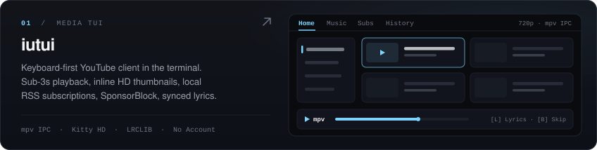
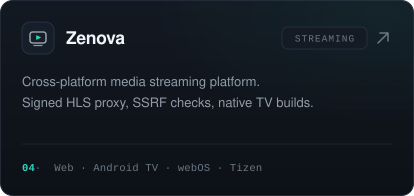
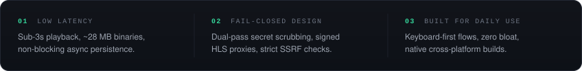

  <picture>
    <source media="(prefers-color-scheme: dark)" srcset="./assets/hero-dark.svg" />
    <source media="(prefers-color-scheme: light)" srcset="./assets/hero-light.svg" />
    
  </picture>

 

<a href="https://github.com/e12jassir/iutui"><picture><source media="(prefers-color-scheme: dark)" srcset="./assets/card-iutui-dark.svg" /><source media="(prefers-color-scheme: light)" srcset="./assets/card-iutui-light.svg" /></picture></a>

<a href="https://github.com/e12jassir/kickoff-cli"><picture><source media="(prefers-color-scheme: dark)" srcset="./assets/card-kickoff-dark.svg" /><source media="(prefers-color-scheme: light)" srcset="./assets/card-kickoff-light.svg" /></picture></a>&nbsp;&nbsp;<a href="https://github.com/e12jassir/Jules"><picture><source media="(prefers-color-scheme: dark)" srcset="./assets/card-jules-dark.svg" /><source media="(prefers-color-scheme: light)" srcset="./assets/card-jules-light.svg" /></picture></a>

<a href="https://github.com/e12jassir/zenova"><picture><source media="(prefers-color-scheme: dark)" srcset="./assets/card-zenova-dark.svg" /><source media="(prefers-color-scheme: light)" srcset="./assets/card-zenova-light.svg" /></picture></a>

  <picture>
    <source media="(prefers-color-scheme: dark)" srcset="./assets/ethos-dark.svg" />
    <source media="(prefers-color-scheme: light)" srcset="./assets/ethos-light.svg" />
    
  </picture>

  
    Also built <a href="https://github.com/e12jassir/atenea">atenea</a>, an encrypted terminal control plane for LMS automation
    &nbsp;&nbsp;·&nbsp;&nbsp;
    <a href="https://zenovaplus.vercel.app">Zenova Live</a>
    &nbsp;&nbsp;·&nbsp;&nbsp;
    <a href="mailto:e12jassir@gmail.com">e12jassir@gmail.com</a>
    &nbsp;&nbsp;·&nbsp;&nbsp;
    <a href="https://github.com/e12jassir?tab=repositories">All Repositories</a>
  

